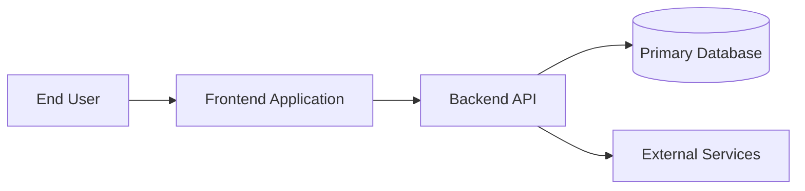
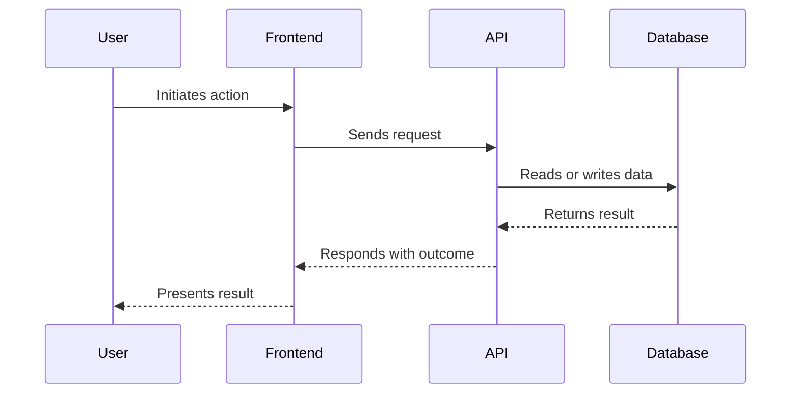
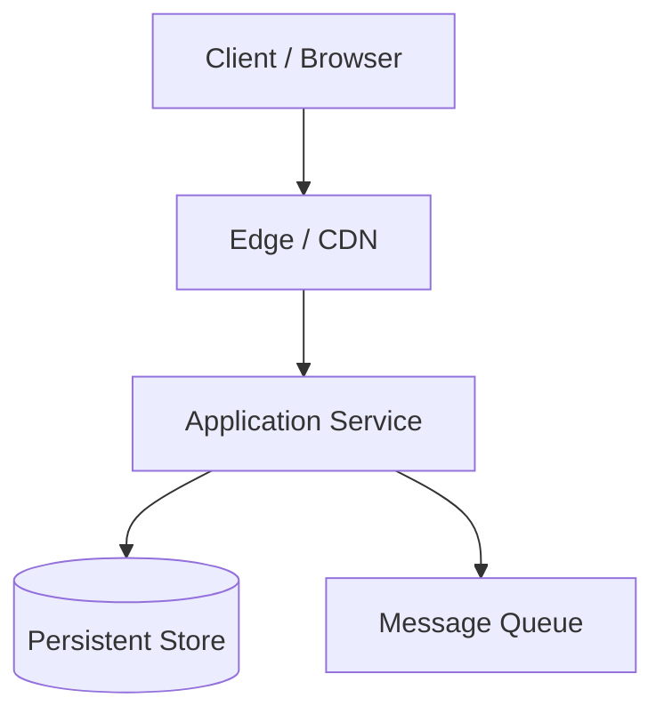

# Architecture

## Overview

- System purpose:
- Architectural style:
- Users and platforms:

## Context diagram

## Runtime sequence

## Technical stack

| Layer         | Choice | Reason |
| ------------- | ------ | ------ |
| Frontend      | ...    | ...    |
| Backend       | ...    | ...    |
| Database      | ...    | ...    |
| Hosting       | ...    | ...    |
| Auth          | ...    | ...    |
| Messaging     | ...    | ...    |
| Observability | ...    | ...    |

## Components

| Component | Responsibility | Depends on |
| --------- | -------------- | ---------- |
| ...       | ...            | ...        |

## Data flow

| Flow | Trigger | Reads | Writes |
| ---- | ------- | ----- | ------ |
| ...  | ...     | ...   | ...    |

Entities and data contracts are in [SCHEMA](SCHEMA.md). Integrations and rollout are in [TRD](TRD.md).

## Deployment view

## Operations

- Environments:
- CI/CD:
- Monitoring and alerting:
- Backups and recovery:

## Risks

- ...
