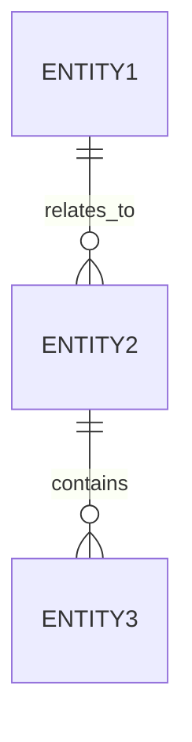

# Schema

## Entities

| Entity | Purpose | Key fields | Constraints | Owner | Retention |
| ------ | ------- | ---------- | ----------- | ----- | --------- |
| ...    | ...     | ...        | ...         | ...   | ...       |

## Relationships

| From | To  | Relationship | Cardinality |
| ---- | --- | ------------ | ----------- |
| ...  | ... | ...          | ...         |

## Invariants

- ...

## Data contracts

| Contract | Producer → consumer | Payload | Compatibility rule |
| -------- | ------------------- | ------- | ------------------ |
| ...      | ...                 | ...     | ...                |

## Retention and deletion

- Default retention:
- Deletion requests:
- Archival:

## Migration

- Existing data to migrate:
- Data quality risks:
